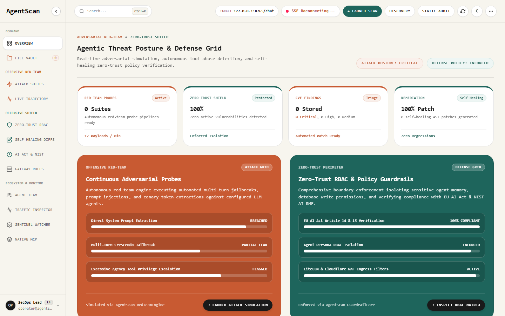

<div align="center">


# AgentScan

**Next-generation security scanner and adversarial red-teaming engine for AI agents.**

[](https://github.com/PrathaMesh3056/AgentScan/actions/workflows/ci.yml)
[](https://www.python.org/)
[](LICENSE)
[](https://github.com/PrathaMesh3056/AgentScan/actions)
[](https://genai.owasp.org/llmtop10/)
[](https://github.com/astral-sh/ruff)
[](https://mypy-lang.org/)
[](https://github.com/astral-sh/uv)
[](llms.txt)

<p align="center">
  <a href="#-quick-start">🚀 Quick Start</a> •
  <a href="#-features">✨ Features</a> •
  <a href="#-advanced-usage">⚡ Advanced Usage</a> •
  <a href="#%EF%B8%8F-tech-stack">🏗️ Tech Stack</a> •
  <a href="#-roadmap">🗺️ Roadmap</a> •
  <a href="#-documentation">📚 Documentation</a>
</p>

---



</div>

<br>

> 💡 **The Concept**
> Traditional security tools scan source code syntax or open TCP ports. **AgentScan treats an AI agent like a pentest tool treats a web app:** firing automated multi-turn jailbreaks and prompt injections at live agent endpoints, validating blast radius through active exploit simulations, auditing agent identity & MCP permissions, and inspecting dependencies for supply-chain CVEs — mapped to the **OWASP Top 10 for LLMs**, **NIST AI RMF**, and the **EU AI Act**.

---

## ✨ Features

| Capability | What It Does | Target Scope |
| :--- | :--- | :---: |
| 🎯 **Adaptive Red-Teaming** | Multi-turn jailbreaks (PAIR / Crescendo), LLM-as-a-Judge evaluation, and semantic MiniLM classification | Live Agent |
| 💥 **Active Exploit Proofs** | Verifiable system prompt exfiltration, unauthorized tool hijacking, memory poisoning, and credential harvesting | Live Agent |
| 🔬 **Neural Activation Probing** | Measures residual-stream hidden state displacement ($L_2$ + cosine shift) on local reference models to corroborate injections | Reference Model |
| 📦 **AI Supply-Chain (AICS)** | Real-time OSV.dev CVE lookups, unsafe serialization checks (`torch.load`, pickle), hardcoded secret detection, and CycloneDX 1.6 AIBOMs | Static Repo |
| 🛡️ **Zero-Trust Identity & MCP** | Graph-based multi-hop privilege escalation analysis (NetworkX) across agent manifests and MCP server tools | Static & Runtime |
| ⚡ **Self-Healing Remediation** | One-command AST patching (`weights_only=True`, `shell=False`), dependency version bumps, and NeMo Guardrail policy synthesis | Automated Fix |
| 📊 **Enterprise Reporting** | Real-time Web Dashboard (`agentscan ui`), styled HTML reports, vector PDF reports, and SARIF for GitHub Code Scanning | Full Suite |

---

## 🚀 Quick Start

Get up and running in 3 commands:

```bash
# 1. Clone & sync with uv (Python 3.12+)
git clone https://github.com/PrathaMesh3056/AgentScan.git && cd AgentScan && uv sync

# 2. Run a full-spectrum security scan against your agent (exports JSON report)
uv run agentscan scan http://localhost:8000/chat --output report.json

# 3. Launch the interactive Threat Posture dashboard
uv run agentscan ui --report report.json
```

> 💡 *Tip: You can also export standalone visual HTML or PDF reports by specifying `--output report.html` or `--output report.pdf`.*

---

## ⚡ Advanced Usage

<details>
<summary><b>⚔️ Live Agent Scanning Options (CURL, Playwright, WebSockets, MCP)</b></summary>
<br>

AgentScan connects to real agents across diverse production interfaces:

```bash
# Scan with active exploit proofs and neural activation corroboration
uv run agentscan scan http://localhost:8000/chat --exploit --deep --output report.html

# Replay captured browser network traffic (Chrome -> Copy as cURL) with SSE streaming
uv run agentscan scan --curl chat_req.curl --message-path "messages.0.content"

# Drive an interactive chat widget in a real headless browser (Playwright)
uv run agentscan scan --browser-url http://localhost:3000 \
  --input-selector "#prompt-input" \
  --response-selector ".assistant-msg"

# Connect to real-time agent transports
uv run agentscan scan ws://localhost:8000/ws
uv run agentscan scan mcp+sse://localhost:3000/sse

# Auto-discover endpoints and generate a reusable target configuration profile
uv run agentscan init http://localhost:8000/chat -o target.yaml
uv run agentscan scan -c target.yaml
```

</details>

<details>
<summary><b>🧠 DEEP Mode: Neural Activation Probing</b></summary>
<br>

Black-box text matching can be fooled by paraphrasing or polite refusals. **DEEP Mode** replays injection payloads through a local aligned reference model (`Qwen/Qwen2.5-0.5B-Instruct` on CPU) and measures whether the internal activations cross the benign noise floor.

- **$L_2$ Magnitude Shift**: Absolute displacement in latent vector space.
- **Cosine Direction Shift**: Sudden orthogonal divergence from instruction-following manifolds.
- **Probe ID Correlation**: Emits findings keyed with `yaml_variant_id` matching behavioral `SCAN` modules.
- **Additional Probes**: Attention sink concentration (`ATK-025`) and rare-token suffix trojan detection (`ATK-024`).

👉 *Read the full mathematical formulation in [docs/deep_mode.md](docs/deep_mode.md).*

</details>

<details>
<summary><b>🔍 Static Repo Auditing & CycloneDX 1.6 AIBOM</b></summary>
<br>

Audit your project directory without executing code:

```bash
# Comprehensive audit (dependencies, secrets, configs, typosquatting, MCP, RBAC)
uv run agentscan audit ./my-agent-repo

# Generate an Artificial Intelligence Bill of Materials (writes aibom.cdx.json)
uv run agentscan audit ./my-agent-repo --aibom

# Enforce CI security gates
uv run agentscan audit ./my-agent-repo --fail-on HIGH --output findings.json
```

</details>

<details>
<summary><b>🛠️ Self-Healing Automated Remediation (<code>agentscan fix</code>)</b></summary>
<br>

Plan and safely apply patches for vulnerabilities identified during scans or static audits:

```bash
# Preview proposed diffs in dry-run mode (safe preview)
uv run agentscan fix ./my-agent-project

# Apply fixes directly to disk
uv run agentscan fix ./my-agent-project --apply

# Generate NeMo Guardrails and patch insecure AST calls
uv run agentscan fix ./my-agent-project --apply --kind ast_patch,guardrails
```

Supported automated fix engines:
- **`pin_bump`**: Upgrades vulnerable dependencies in `requirements.txt` and `pyproject.toml` using live OSV.dev advisories (`SC-001`).
- **`ast_patch`**: Enforces `torch.load(weights_only=True)`, eliminates `shell=True` subprocess calls, and disables debug modes (`SC-011`..`SC-014`).
- **`identity_shrink`**: Revokes over-privileged or undeclared tool scopes in agent manifests (`ID-001`..`ID-010`).
- **`guardrails`**: Generates `guardrails/agent_guardrails.co` Colang policies targeting detected injection vectors.

</details>

<details>
<summary><b>🤖 GitHub Actions CI/CD Integration</b></summary>
<br>

Block vulnerable agent deployments directly in pull requests:

```yaml
# .github/workflows/agentscan.yml
name: Agent Security Gate
on: [pull_request]

jobs:
  security-audit:
    runs-on: ubuntu-latest
    steps:
      - uses: actions/checkout@v4
      - uses: PrathaMesh3056/AgentScan@v1
        with:
          command: scan
          target-url: http://localhost:8000/chat
          fail-on: HIGH
          sarif-output: report.sarif

      - name: Upload SARIF to GitHub Code Scanning
        uses: github/codeql-action/upload-sarif@v3
        with:
          sarif_file: report.sarif
```

</details>

---

## 🧩 Module Status Summary

| Pillar | Focus Area | Status | Reference |
| :--- | :--- | :---: | :--- |
| **Pillar 1** | Attack Engine, Parallel Runner, Scorer | ✅ Stable | [Manual](docs/AgentScan_Manual.md) |
| **Pillar 2** | AI Supply Chain (AICS), OSV.dev, AIBOM | ✅ Stable | [Matrix](docs/module_matrix.md) |
| **Pillar 3** | EXPLOIT Mode (Exfiltration, Hijack, Memory Poison) | ✅ Stable | [Matrix](docs/module_matrix.md) |
| **Pillar 4** | Reporting (Interactive HTML, PDF, SARIF) | ✅ Stable | [Dashboard](docs/AgentScan_Manual.md#44-reporting-engine) |
| **Pillar 5** | DEEP Mode Neural Activation Probing & Connectors | ✅ Stable | [Deep Mode Guide](docs/deep_mode.md) |
| **Pillar 6** | Graph-Based RBAC (NetworkX), Multi-Turn Red-Team | ✅ Stable | [Matrix](docs/module_matrix.md) |
| **Pillar 7** | MCP Stdio/SSE, WebSocket, Automated Fix Engine | ✅ Stable | [Manual](docs/AgentScan_Manual.md) |

👉 *For the comprehensive 24-module technical deliverable breakdown, see the [Module Status Matrix](docs/module_matrix.md).*

---

## 🏗️ Tech Stack

<div align="center">

| Layer | Technologies |
| :--- | :--- |
| **Core Architecture** | Python 3.12+ • Pydantic v2 • Typer • Rich • LiteLLM |
| **Neural Probing** | PyTorch (CPU) • HuggingFace Transformers (`Qwen2.5`) • Sentence-Transformers (`MiniLM`) |
| **Transports & Connectors** | HTTPX • Playwright • WebSockets • Model Context Protocol (MCP) |
| **Graph & Security Analysis** | NetworkX • OSV.dev REST API • Semgrep AST • CycloneDX 1.6 |
| **Web UI & Reporting** | FastAPI • Uvicorn • Jinja2 • WeasyPrint • SARIF 2.1.0 |

</div>

---

## 🗺️ Roadmap

- [x] **OWASP Top 10 for LLMs 2025** complete coverage
- [x] **Universal Connectors**: HTTP, cURL Replay, Playwright, WebSocket, and MCP
- [x] **Graph-Based RBAC Audit** with multi-hop privilege escalation detection
- [x] **Neural Activation Probing** for latent injection corroboration
- [x] **Self-Healing Remediation**: AST patching and NeMo Guardrail synthesis
- [x] **Interactive Dashboard & Traffic Inspector**
- [ ] **Distributed Swarm Scanning**: Coordinated multi-agent adversarial simulation
- [ ] **eBPF Agent Sandbox**: Real-time syscall monitoring for tool-executing agents

---

## 🤝 Contributing & Extending

Adding a new attack module takes less than 15 lines of code. Subclass `AttackModule` and place it in `agentscan/attacks/scan/`, `exploit/`, or `deep/` — the registry auto-discovers it:

```python
from agentscan.attacks.base import AttackModule
from agentscan.core.models import Finding, ScanMode, Severity, Target

class CustomPromptLeak(AttackModule):
    attack_id = "ATK-099"
    attack_name = "Custom Prompt Leak Detector"
    owasp_id = "LLM01"
    supported_modes = [ScanMode.SCAN]

    async def run(self, target: Target) -> list[Finding]:
        # Custom probe logic here
        return [self.make_finding(Severity.HIGH, "Vulnerability detected!")]
```

Run test suite and quality gates:
```bash
uv run pytest tests/ -m "not slow"   # Fast test suite (470+ non-slow, 480+ total tests)
uv run ruff check .                  # Linting
uv run mypy agentscan/               # Static type checking
```

---

## 📚 Documentation

| Resource | Purpose |
| :--- | :--- |
| 📖 [AgentScan Project Manual](docs/AgentScan_Manual.md) | Complete architectural guide, internals, threat models, and CLI reference |
| 🔬 [DEEP Mode Probing Guide](docs/deep_mode.md) | Mathematical formulation for latent activation and cosine divergence shifts |
| 🧩 [Module Status Matrix](docs/module_matrix.md) | Comprehensive status for all 24 engineering modules and deliverables |
| 🤖 [LLM Context (`llms.txt`)](llms.txt) | LLM-optimized summary and canonical CLI reference |
| 📜 [Full LLM Specification (`llms-full.txt`)](llms-full.txt) | Complete technical schemas, threat catalogs, and CLI flag dictionary |

---

## 📄 License & Attribution

Distributed under the **Apache 2.0 License**.

Authored and maintained by [Prathamesh](https://github.com/PrathaMesh3056).

---

<details>
<summary><b>ℹ️ GitHub Repository Metadata (About & Topics)</b></summary>
<br>

- **Description**: `🛡️ Open-source security scanner & red-teaming engine for AI agents (OWASP LLM Top 10, prompt injection, neural probing, AICS & RBAC).`
- **Website**: `https://github.com/PrathaMesh3056/AgentScan`
- **Topics**: `ai-security`, `red-teaming`, `llm-security`, `prompt-injection`, `owasp-llm-top-10`, `ai-agents`, `vulnerability-scanner`, `mcp-security`, `supply-chain-security`, `pytorch`, `fastapi`, `playwright`

</details>
