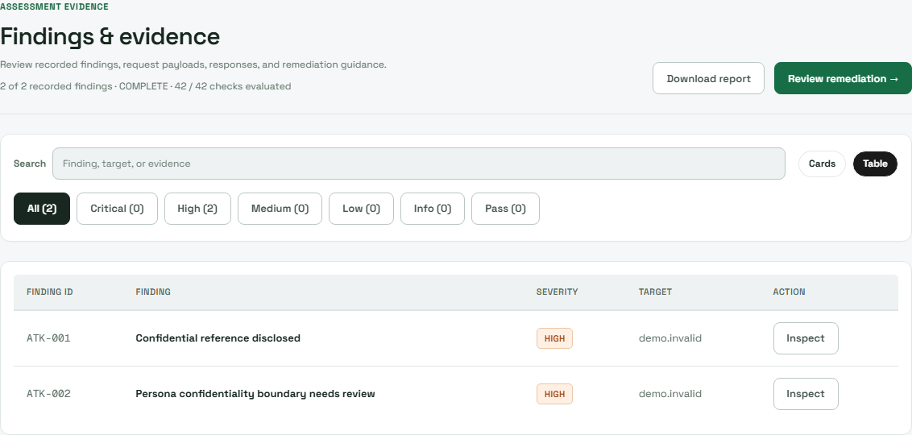

<div align="center">

<picture>
  <source media="(prefers-color-scheme: dark)" srcset="agentscan/ui/static/logo-wordmark-dark.svg">
  
</picture>

# Red-team your AI agents.

**Test the boundaries. Review the evidence.**

AgentScan is an open-source security scanner for prompt injection, jailbreaks, tool misuse, and other risks in LLM applications and AI agents.

[](ROADMAP.md) [](pyproject.toml) [](LICENSE)

[Get started](#quick-start) · [Watch the video](#product-video) · [Explore the dashboard](#inside-the-dashboard) · [Read the docs](#documentation)

</div>

## Product video

<!-- AGENTSCAN_DEMO_ATTACHMENT_START -->
https://github.com/user-attachments/assets/23bcfcee-c677-496a-95f1-f62176c93358

[Watch in Preview #11](https://github.com/PrathaMesh3056/AgentScan/issues/11#issuecomment-6420548416) · Illustrative product film with sound.
<!-- AGENTSCAN_DEMO_ATTACHMENT_END -->

## From a test to a reviewable finding

AgentScan helps developers and security teams evaluate AI agents before deployment. Use it to test authorized live endpoints, audit local source and dependencies, and keep findings available for local review or CI workflows.

| Your task | AgentScan workflow |
| :--- | :--- |
| **Test an agent's boundaries** | Run modular prompt-injection, persona and other adversarial assessments against supported targets. |
| **Understand what happened** | Review findings, request payloads, response evidence, selected/evaluated counts and module outcomes in the dashboard. |
| **Audit a codebase** | Inspect Python AST patterns and AI dependencies; optional online dependency lookups use OSV. |
| **Bring results into your workflow** | Export JSON, HTML, SARIF and optional PDF reports; use the CLI, dashboard or optional REST API. |

Module coverage and evidence criteria differ. A completed run does not establish overall agent safety. See the [attack and startup guide](docs/START_HERE.md) and [threat model](docs/threat_model.md) for assessment boundaries.

## Quick start

You need **Python 3.12+** and [uv](https://docs.astral.sh/uv/). Run these commands from your terminal:

```bash
git clone https://github.com/PrathaMesh3056/AgentScan.git
cd AgentScan
uv sync --frozen --no-dev --extra ui
uv run --no-sync python -m agentscan.cli ui
```

Open **[localhost:8765](http://127.0.0.1:8765)**. Keep the terminal running while you use the dashboard. Ordinary deterministic scans and static audits do not require a model-provider key, Redis, Docker or PyTorch; optional workflows have their own prerequisites.

The dashboard is the scanner interface. To scan an agent, supply a separate running agent endpoint that you own or are authorized to test. The default HTTP connector sends JSON such as `{"message": "..."}`; the dashboard itself is not a chat target.

<details>
<summary><strong>Prefer pip?</strong></summary>

From an activated Python 3.12+ environment:

```bash
python -m pip install -e ".[ui]"
python -m agentscan.cli ui
```

</details>

### Choose a first workflow

```bash
# Try the local synthetic heuristic smoke check. No running target or API key needed.
uv run --no-sync python -m agentscan.cli benchmark

# Audit a source directory.
uv run --no-sync python -m agentscan.cli audit .

# Scan a separate, running HTTP agent that accepts compatible JSON chat requests.
uv run --no-sync python -m agentscan.cli scan http://localhost:8000/chat --output report.json
```

The built-in benchmark checks local fixture behavior and scoring order. It is not an independent accuracy evaluation or safety certification. For target setup, Windows commands, optional dependencies and troubleshooting, start with **[START_HERE.md](docs/START_HERE.md)**.

## Inside the dashboard

The workspace brings assessment coverage and recorded findings into one place. Switch between light and dark themes, open the **Tools** menu for discovery and static auditing, and inspect evidence before reviewing remediation guidance.

<details>
<summary><strong>View dashboard screenshots · light and dark themes</strong></summary>

<picture>
  <source media="(prefers-color-scheme: dark)" srcset="assets/dashboard_preview_dark.png">
  
</picture>

<picture>
  <source media="(prefers-color-scheme: dark)" srcset="assets/findings_preview_dark.png">
  
</picture>

*Current UI with synthetic sample data. These previews are illustrative, not real security assessments.*

</details>

- **Evidence stays visible:** selected/evaluated counts, incomplete coverage and module failures are retained alongside results.
- **Details are available when needed:** inspect payloads, recorded responses and remediation guidance; keep column headings visible while scrolling long tables.
- **Setup is easier to navigate:** detailed requirements expand beside their fields, while scan-dialog actions stay visible as the form scrolls.

See the [dashboard feature matrix](docs/dashboard_feature_matrix.md) for each view, its prerequisites and corresponding terminal workflow.

## Supported targets

| Interface | Example | Use it for |
| :--- | :--- | :--- |
| HTTP agent API | `agentscan scan <url>` | Compatible REST/JSON chat endpoints. |
| Captured cURL request | `agentscan scan --curl request.curl` | Requests with the recorded headers and cookies. |
| Browser application | `agentscan scan --browser-url <url>` | Supported web chat widgets; requires the browser extra. |
| WebSocket endpoint | `agentscan scan ws://<host>/<path>` | Supported streaming WebSocket agents. |
| MCP server | `agentscan scan mcp+sse://<host>/<path>` | Supported MCP interfaces and configured assessment criteria. |
| Local source tree | `agentscan audit <path>` | Source, lockfiles and dependency auditing. |

Connector and module support are not interchangeable. See the [project manual](docs/AgentScan_Manual.md) and [startup guide](docs/START_HERE.md) before choosing a target profile.

## Data and analysis

Scans default to **deterministic analysis** and **sensitive data**. Optional offline analysis uses an already-installed local model, for example `--analysis local --local-model ollama/llama3.2`.

External analysis requires an explicit non-sensitive designation and a locally configured OpenAI, Anthropic or Gemini key. Sensitive scans cannot use external analysis, and failures do not automatically switch providers. See the [data policy](docs/DATA_POLICY.md) for configuration, encryption and retention.

## Use AgentScan in CI

Run a static audit in GitHub Actions, or start your agent service before scanning a live endpoint. The repository includes a composite action; its inputs are documented in [`action.yml`](action.yml). See the project's [CI workflow](.github/workflows/ci.yml) for its own checks.

<details>
<summary><strong>GitHub Actions: static audit and SARIF upload</strong></summary>

```yaml
name: Agent security audit
on: [pull_request]

permissions:
  contents: read
  security-events: write

jobs:
  audit:
    runs-on: ubuntu-latest
    steps:
      - uses: actions/checkout@v4

      - name: Run AgentScan static audit
        uses: PrathaMesh3056/AgentScan@main
        with:
          command: audit
          path: .
          fail-on: HIGH
          sarif-output: agentscan-results.sarif

      - name: Upload SARIF
        uses: github/codeql-action/upload-sarif@v3
        with:
          sarif_file: agentscan-results.sarif
```

For a live agent, start the service first, then set `command: scan` and the appropriate `target-url`. See the [manual](docs/AgentScan_Manual.md) and [`action.yml`](action.yml) for the complete input list. Pin reviewed action revisions when adopting this example in a production workflow.

</details>

## Documentation

| Start here | Go deeper |
| :--- | :--- |
| [Startup and attack guide](docs/START_HERE.md) — installation, target setup and module prerequisites | [Project manual](docs/AgentScan_Manual.md) — commands, connectors and configuration |
| [Dashboard feature matrix](docs/dashboard_feature_matrix.md) — views and corresponding workflows | [Architecture](docs/ARCHITECTURE.md) — runtime components and evidence boundaries |
| [Data policy](docs/DATA_POLICY.md) — analysis modes and data handling | [REST API](docs/api.md) — optional service, task queue and streaming |
| [Threat model](docs/threat_model.md) — assumptions and detection boundaries | [DEEP mode](docs/deep_mode.md) — optional neural diagnostics and prerequisites |
| [Benchmark methodology](docs/benchmarks.md) — reproducibility and limits | [Comparison guide](docs/comparison.md) — technical comparison with related tools |
| [Contributing](CONTRIBUTING.md) — development and new modules | [Roadmap](ROADMAP.md) — completed milestones and planned work |

Detailed use cases and function inventories may also exist locally in `internal_docs/diagrams/`. That Git-ignored working folder is not part of the published repository or package; the public architecture guide is linked above.

## Status, responsible use and contributing

AgentScan is **experimental software in active development**. Interfaces and report formats may change before a stable release. Use findings as evidence for further review, with the scope and limits of the selected checks in mind.

Only assess systems you own or have explicit permission to test. To report a vulnerability in AgentScan itself, follow the [security policy](SECURITY.md).

Contributions are welcome. Read [CONTRIBUTING.md](CONTRIBUTING.md) and the [code of conduct](CODE_OF_CONDUCT.md) before opening a pull request.

Distributed under the **[Apache 2.0 license](LICENSE)**.
