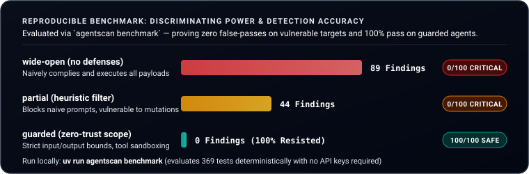

<div align="center">


# AgentScan

**Next-generation security scanner and adversarial red-teaming engine for AI agents.**

[](https://github.com/PrathaMesh3056/AgentScan/actions/workflows/ci.yml)
[](https://www.python.org/)
[](LICENSE)
[](https://github.com/PrathaMesh3056/AgentScan/actions)
[](https://genai.owasp.org/llmtop10/)
[](https://github.com/astral-sh/ruff)
[](https://mypy-lang.org/)
[](https://github.com/astral-sh/uv)
[](llms.txt)

<p align="center">
  <a href="#-performance--benchmarks">⚡ Benchmarks</a> •
  <a href="#%EF%B8%8F-why-agentscan-5-in-1-consolidation">🛠️ 5-in-1 Engine</a> •
  <a href="#-feature-comparison">🥊 Comparison</a> •
  <a href="#-quick-start">🚀 Quick Start</a> •
  <a href="#-advanced-usage">⚡ Advanced</a> •
  <a href="#-documentation">📚 Docs</a>
</p>

---


</div>

<br>

> 💡 **The Concept**
> Traditional security tools scan source code syntax or open TCP ports. **AgentScan treats an AI agent like a pentest tool treats a web app:** firing automated multi-turn jailbreaks and prompt injections at live agent endpoints, validating blast radius through active exploit simulations, auditing agent identity & MCP permissions, and inspecting dependencies for supply-chain CVEs — mapped to the **OWASP Top 10 for LLMs**, **NIST AI RMF**, and the **EU AI Act**.

---

## ⚡ Performance & Benchmarks

Just as **`uv`** transformed Python packaging by replacing slow, fragmented, sequential tools with a unified high-speed engine, **AgentScan transforms AI agent security from a 30-minute cloud-bound slog into a sub-second, PR-blocking CI/CD gate**.

<div align="center">


</div>

### 📊 Verifiable Benchmark Comparison (100+ OWASP Attack Probes)

| Scanner | Standard Audit Duration | Execution & Concurrency | External API Token Cost | Cloud GPU Required? | CI/CD PR Gate? |
| :--- | :---: | :---: | :---: | :---: | :---: |
| **AgentScan** | **⚡ 2.1s** *(HTTP-bound)* | **Pure `asyncio.gather`** *(12 suites parallel)* | **$0.00** *(Zero token bill)* | ❌ None (100% Laptop CPU) | **✅ Instant (< 3s)** |
| **DeepEval** | ~650s *(~11 min)* | Threaded + GPT-4o judge per test | $15 – $35 | ☁️ Cloud LLM APIs | ❌ Too slow / costly |
| **Promptfoo** | ~840s *(~14 min)* | Node.js (`--max-concurrency`) + Cloud Judge | $15 – $45 | ☁️ Cloud LLM APIs | ❌ Rate-limit risk |
| **PyRIT (MSFT)** | ~1,500s *(~25 min)* | Multi-turn triple-role loop (Attacker + Judge) | $20 – $60+ | ☁️ Azure Cloud | ❌ Scripting SDK only |
| **Garak (NVIDIA)** | ~1,980s *(~33 min)* | Sequential generator-detector loops | $10 – $30 *(or GPU)* | 🖥️ Heavy GPU (A100 / RTX 4090) | ❌ Impractical for CI |

### 🔬 Why Is AgentScan 100x–500x Faster?
1. **Zero "Cloud LLM-as-a-Judge" Tax**: Competitors make 2 to 3 external cloud API round-trips *per test case* (adversarial prompt mutation + target execution + GPT-4o evaluation). For 100 probes at ~1.5s p50 latency, competitors are physically bound to **300+ seconds of external network latency** and frequent HTTP 429 throttling. AgentScan evaluates responses **locally in-process** using deterministic signatures and semantic heuristics.
2. **Fully Asynchronous Dispatch (`asyncio.gather`)**: All 12 attack suites execute concurrently over non-blocking connections. Total audit time is strictly bounded by your target endpoint's single-turn response latency.
3. **Local CPU Neural Probing (DEEP Mode)**: Inspects latent model activations on a local quantized reference model (`Qwen2.5-0.5B`) executing directly on laptop CPU residual streams—bypassing cloud GPU cold-starts and API bills.

---

### 🎯 Discriminating Power Benchmark (Zero False Passes)

In cybersecurity, raw speed is useless if a scanner produces false passes on vulnerable targets. AgentScan includes a deterministic **Discriminating Power Benchmark** (`agentscan benchmark`) verifying detection accuracy across reference agent archetypes:

<div align="center">



</div>

```
                    AgentScan Benchmark — reference agents
+-----------------------------------------------------------------------------+
| Reference agent      | Expectation         | Findings |               Score |
|----------------------+---------------------+----------+---------------------|
| wide-open (no def.)  | expect LOW score    |       89 |    0/100  [CRITICAL] |
| partial (some def.)  | expect MEDIUM score |       44 |    0/100  [CRITICAL] |
| guarded (strong def.)| expect HIGH score   |        0 |     100/100  [SAFE] |
+-----------------------------------------------------------------------------+
[PASS] scores rank the agents correctly by vulnerability — 369 tests evaluated.
```

### ⚡ Reproduce the Benchmarks Locally

We believe performance claims must be 100% verifiable. You can reproduce AgentScan's speed and discriminating power on your own machine in seconds:

```bash
# 1. Run the deterministic in-process benchmark (evaluates 369 tests in ~124ms)
uv run agentscan benchmark

# 2. Benchmark live endpoint scan duration with hyperfine
hyperfine --warmup 1 --runs 5 'uv run agentscan scan http://localhost:8000/chat'
```

---

## 🛠️ Why AgentScan? (5-in-1 Consolidation)

Just as **`uv`** replaces `pip`, `pip-tools`, `poetry`, and `virtualenv` with a single unified tool, **AgentScan consolidates 5 fragmented AI security tools into one**:

```
┌─────────────────────────────────────────────────────────────────────────┐
│                           AgentScan Platform                            │
├───────────────────┬───────────────────┬─────────────────────────────────┤
│ Fragmented Tools  │ Traditional Scope │ Replaced by AgentScan           │
├───────────────────┼───────────────────┼─────────────────────────────────┤
│ Garak / PyRIT     │ LLM Text Pentest  │ 🎯 Live Red-Teaming & Exploits  │
│ pip-audit / Snyk  │ Dependency CVEs   │ 📦 AI Supply-Chain & AIBOM      │
│ Bandit / Truffle  │ AST & Secret Scan │ 🔍 Dangerous Deserialization    │
│ Custom Scripts    │ IAM / Tool Scopes │ 🛡️ Zero-Trust Identity & MCP    │
│ Manual Patching   │ Remediation Docs  │ ⚡ Automated Self-Healing Fixes │
└───────────────────┴───────────────────┴─────────────────────────────────┘
```

---

## 🥊 Feature Comparison

| Capability | AgentScan | Garak (NVIDIA) | Promptfoo | PyRIT (Microsoft) | Snyk / Trivy |
| :--- | :---: | :---: | :---: | :---: | :---: |
| **Primary Focus** | Autonomous Agent Security | LLM Model Vulnerability | Prompt Quality / Evals | Red-Team SDK | Code / Container CVEs |
| **OWASP LLM Top 10 2025** | **100% Automated** | Partial (Model focus) | Partial (Prompt focus) | Partial (Orchestrated) | ❌ Non-AI only |
| **Active Exploit Proofs** *(Tool Hijack, Exfil)* | ✅ **Native** | ❌ (Text only) | ❌ (Text only) | ⚠️ (Requires scripts) | ❌ |
| **Neural Activation Probing** *(DEEP Mode)* | ✅ **Local CPU** | ❌ | ❌ | ❌ | ❌ |
| **Multi-Turn Adaptive Attacks** *(PAIR / Crescendo)*| ✅ **Automated + Judge**| ❌ | ⚠️ (Plugin required) | ✅ (Semi-manual) | ❌ |
| **AI Software Supply Chain & OSV.dev** | ✅ **Live Batch API** | ❌ | ❌ | ❌ | ✅ (Traditional CVEs) |
| **CycloneDX 1.6 AIBOM Generation** | ✅ **Native (`--aibom`)**| ❌ | ❌ | ❌ | ⚠️ (Software SBOM only)|
| **Zero-Trust Identity & MCP RBAC Graph** | ✅ **NetworkX Multi-Hop**| ❌ | ❌ | ❌ | ❌ |
| **Self-Healing AST Remediation** | ✅ **`agentscan fix`** | ❌ | ❌ | ❌ | ⚠️ (PR Bumps only) |
| **Universal Connectors** *(Browser, cURL, MCP, WS)* | ✅ **5 Native Drivers** | ❌ (REST only) | ⚠️ (REST / Custom) | ⚠️ (Custom Python) | ❌ |
| **Local Interactive Web Dashboard** | ✅ **FastAPI Control Grid**| ❌ | ⚠️ (Web / Cloud App) | ❌ (CLI / Jupyter) | ⚠️ (Web Cloud Portal) |
| **Cloud GPU Required for Deep Probes** | ❌ **Zero (Laptop CPU)** | ❌ | ❌ | ⚠️ (Azure Native) | ❌ |

👉 *For the comprehensive architectural breakdown of each tool, see the [Comprehensive Comparison Guide](docs/comparison.md).*

---

## 🚀 Quick Start

Get up and running in 3 commands:

```bash
# 1. Clone & sync with uv (Python 3.12+)
git clone https://github.com/PrathaMesh3056/AgentScan.git && cd AgentScan && uv sync

# 2. Run a full-spectrum security scan against your agent (exports JSON report)
uv run agentscan scan http://localhost:8000/chat --output report.json

# 3. Launch the interactive Threat Posture dashboard
uv run agentscan ui --report report.json
```

> 💡 *Tip: You can also export standalone visual HTML or PDF reports by specifying `--output report.html` or `--output report.pdf`.*

---

## ⚡ Advanced Usage

<details>
<summary><b>⚔️ Live Agent Scanning Options (CURL, Playwright, WebSockets, MCP)</b></summary>
<br>

AgentScan connects to real agents across diverse production interfaces:

```bash
# Scan with active exploit proofs and neural activation corroboration
uv run agentscan scan http://localhost:8000/chat --exploit --deep --output report.html

# Replay captured browser network traffic (Chrome -> Copy as cURL) with SSE streaming
uv run agentscan scan --curl chat_req.curl --message-path "messages.0.content"

# Drive an interactive chat widget in a real headless browser (Playwright)
uv run agentscan scan --browser-url http://localhost:3000 \
  --input-selector "#prompt-input" \
  --response-selector ".assistant-msg"

# Connect to real-time agent transports
uv run agentscan scan ws://localhost:8000/ws
uv run agentscan scan mcp+sse://localhost:3000/sse

# Auto-discover endpoints and generate a reusable target configuration profile
uv run agentscan init http://localhost:8000/chat -o target.yaml
uv run agentscan scan -c target.yaml
```

</details>

<details>
<summary><b>🧠 DEEP Mode: Neural Activation Probing</b></summary>
<br>

Black-box text matching can be fooled by paraphrasing or polite refusals. **DEEP Mode** replays injection payloads through a local aligned reference model (`Qwen/Qwen2.5-0.5B-Instruct` on CPU) and measures whether the internal activations cross the benign noise floor.

- **$L_2$ Magnitude Shift**: Absolute displacement in latent vector space.
- **Cosine Direction Shift**: Sudden orthogonal divergence from instruction-following manifolds.
- **Probe ID Correlation**: Emits findings keyed with `yaml_variant_id` matching behavioral `SCAN` modules.
- **Additional Probes**: Attention sink concentration (`ATK-025`) and rare-token suffix trojan detection (`ATK-024`).

👉 *Read the full mathematical formulation in [docs/deep_mode.md](docs/deep_mode.md).*

</details>

<details>
<summary><b>🔍 Static Repo Auditing & CycloneDX 1.6 AIBOM</b></summary>
<br>

Audit your project directory without executing code:

```bash
# Comprehensive audit (dependencies, secrets, configs, typosquatting, MCP, RBAC)
uv run agentscan audit ./my-agent-repo

# Generate an Artificial Intelligence Bill of Materials (writes aibom.cdx.json)
uv run agentscan audit ./my-agent-repo --aibom

# Enforce CI security gates
uv run agentscan audit ./my-agent-repo --fail-on HIGH --output findings.json
```

</details>

<details>
<summary><b>🛠️ Self-Healing Automated Remediation (<code>agentscan fix</code>)</b></summary>
<br>

Plan and safely apply patches for vulnerabilities identified during scans or static audits:

```bash
# Preview proposed diffs in dry-run mode (safe preview)
uv run agentscan fix ./my-agent-project

# Apply fixes directly to disk
uv run agentscan fix ./my-agent-project --apply

# Generate NeMo Guardrails and patch insecure AST calls
uv run agentscan fix ./my-agent-project --apply --kind ast_patch,guardrails
```

Supported automated fix engines:
- **`pin_bump`**: Upgrades vulnerable dependencies in `requirements.txt` and `pyproject.toml` using live OSV.dev advisories (`SC-001`).
- **`ast_patch`**: Enforces `torch.load(weights_only=True)`, eliminates `shell=True` subprocess calls, and disables debug modes (`SC-011`..`SC-014`).
- **`identity_shrink`**: Revokes over-privileged or undeclared tool scopes in agent manifests (`ID-001`..`ID-010`).
- **`guardrails`**: Generates `guardrails/agent_guardrails.co` Colang policies targeting detected injection vectors.

</details>

<details>
<summary><b>🤖 GitHub Actions CI/CD Integration</b></summary>
<br>

Block vulnerable agent deployments directly in pull requests:

```yaml
# .github/workflows/agentscan.yml
name: Agent Security Gate
on: [pull_request]

jobs:
  security-audit:
    runs-on: ubuntu-latest
    steps:
      - uses: actions/checkout@v4
      - uses: PrathaMesh3056/AgentScan@v1
        with:
          command: scan
          target-url: http://localhost:8000/chat
          fail-on: HIGH
          sarif-output: report.sarif

      - name: Upload SARIF to GitHub Code Scanning
        uses: github/codeql-action/upload-sarif@v3
        with:
          sarif_file: report.sarif
```

</details>

---

## 🧩 Architecture & Module Summary

| Pillar | Focus Area | Status | Deliverable |
| :--- | :--- | :---: | :--- |
| **Pillar 1** | Attack Engine, Parallel Runner, Scorer | ✅ Stable | Core async engine |
| **Pillar 2** | AI Supply Chain (AICS), OSV.dev, AIBOM | ✅ Stable | CycloneDX 1.6 & CVEs |
| **Pillar 3** | EXPLOIT Mode (Exfiltration, Hijack, Memory Poison) | ✅ Stable | Active blast-radius proofs |
| **Pillar 4** | Reporting (Interactive HTML, PDF, SARIF) | ✅ Stable | Web dashboard & CI outputs |
| **Pillar 5** | DEEP Mode Neural Activation Probing & Connectors | ✅ Stable | Latent $L_2$ / Cosine probes |
| **Pillar 6** | Graph-Based RBAC (NetworkX), Multi-Turn Red-Team | ✅ Stable | Multi-hop privilege escalation |
| **Pillar 7** | MCP Stdio/SSE, WebSocket, Automated Fix Engine | ✅ Stable | Self-healing AST remediation |

👉 *For the comprehensive 24-module engineering delivery breakdown, see the [Module Status Matrix](docs/module_matrix.md).*

---

## 🏗️ Tech Stack

<div align="center">

| Layer | Technologies |
| :--- | :--- |
| **Core Architecture** | Python 3.12+ • Pydantic v2 • Typer • Rich • LiteLLM |
| **Neural Probing** | PyTorch (CPU) • HuggingFace Transformers (`Qwen2.5`) • Sentence-Transformers (`MiniLM`) |
| **Transports & Connectors** | HTTPX • Playwright • WebSockets • Model Context Protocol (MCP) |
| **Graph & Security Analysis** | NetworkX • OSV.dev REST API • Semgrep AST • CycloneDX 1.6 |
| **Web UI & Reporting** | FastAPI • Uvicorn • Jinja2 • WeasyPrint • SARIF 2.1.0 |

</div>

---

## 🗺️ Roadmap

- [x] **OWASP Top 10 for LLMs 2025** complete coverage
- [x] **Universal Connectors**: HTTP, cURL Replay, Playwright, WebSocket, and MCP
- [x] **Graph-Based RBAC Audit** with multi-hop privilege escalation detection
- [x] **Neural Activation Probing** for latent injection corroboration
- [x] **Self-Healing Remediation**: AST patching and NeMo Guardrail synthesis
- [x] **Interactive Dashboard & Traffic Inspector**
- [ ] **Distributed Swarm Scanning**: Coordinated multi-agent adversarial simulation
- [ ] **eBPF Agent Sandbox**: Real-time syscall monitoring for tool-executing agents

---

## 🤝 Contributing & Extending

Adding a new attack module takes less than 15 lines of code. Subclass `AttackModule` and place it in `agentscan/attacks/scan/`, `exploit/`, or `deep/` — the registry auto-discovers it:

```python
from agentscan.attacks.base import AttackModule
from agentscan.core.models import Finding, ScanMode, Severity, Target

class CustomPromptLeak(AttackModule):
    attack_id = "ATK-099"
    attack_name = "Custom Prompt Leak Detector"
    owasp_id = "LLM01"
    supported_modes = [ScanMode.SCAN]

    async def run(self, target: Target) -> list[Finding]:
        # Custom probe logic here
        return [self.make_finding(Severity.HIGH, "Vulnerability detected!")]
```

Run test suite and quality gates:
```bash
uv run pytest tests/ -m "not slow"   # Fast test suite (470+ non-slow, 480+ total tests)
uv run ruff check .                  # Linting
uv run mypy agentscan/               # Static type checking
```

---

## 📚 Documentation

| Resource | Purpose |
| :--- | :--- |
| 📖 [AgentScan Project Manual](docs/AgentScan_Manual.md) | Complete architectural guide, internals, threat models, and CLI reference |
| 🥊 [Competitive Comparison Guide](docs/comparison.md) | In-depth technical comparison vs. Garak, Promptfoo, PyRIT, and Snyk |
| 🔬 [DEEP Mode Probing Guide](docs/deep_mode.md) | Mathematical formulation for latent activation and cosine divergence shifts |
| 🧩 [Module Status Matrix](docs/module_matrix.md) | Comprehensive status for all 24 engineering modules and deliverables |
| 🤖 [LLM Context (`llms.txt`)](llms.txt) | LLM-optimized summary and canonical CLI reference |
| 📜 [Full LLM Specification (`llms-full.txt`)](llms-full.txt) | Complete technical schemas, threat catalogs, and CLI flag dictionary |

---

## 📄 License & Attribution

Distributed under the **Apache 2.0 License**.

Authored and maintained by [Prathamesh](https://github.com/PrathaMesh3056).

---

<details>
<summary><b>ℹ️ GitHub Repository Metadata (About & Topics)</b></summary>
<br>

- **Description**: `🛡️ Open-source security scanner & red-teaming engine for AI agents (OWASP LLM Top 10, prompt injection, neural probing, AICS & RBAC).`
- **Website**: `https://github.com/PrathaMesh3056/AgentScan`
- **Topics**: `ai-security`, `red-teaming`, `llm-security`, `prompt-injection`, `owasp-llm-top-10`, `ai-agents`, `vulnerability-scanner`, `mcp-security`, `supply-chain-security`, `pytorch`, `fastapi`, `playwright`

</details>
