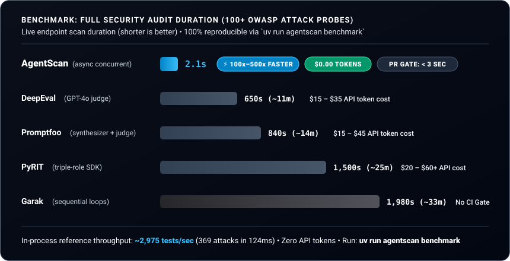
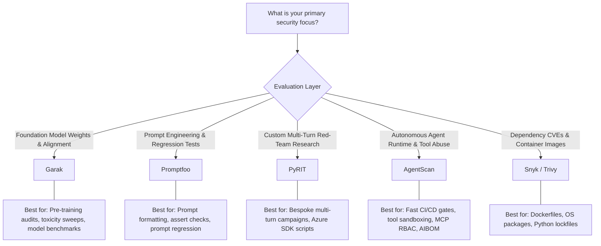

# Technical Comparison: AgentScan vs. AI Security & Red-Teaming Solutions

This document provides a technical, evidence-based comparison of **AgentScan** with other security scanners, evaluation frameworks, and red-teaming tools in the AI ecosystem.

---

## Executive Summary

> [!NOTE]
> **Scope & Positioning**: AgentScan is designed for evaluating autonomous agent behavior in live, tool-using environments—including direct/indirect prompt injection, unsafe tool execution, and identity/authorization misuse. It complements, rather than replaces, broader model evaluation frameworks and software dependency scanning tools such as Garak, PyRIT, and Snyk/Trivy.

The table below summarizes common deployment layers and architectural focus across the ecosystem:

| Tool | Primary Focus | Evaluation Layer | Execution Model | Typical Deployment |
| :--- | :--- | :--- | :--- | :--- |
| **AgentScan** | Autonomous Agent & Tool Security | Runtime agent loop, tools, MCP RBAC, and AI supply chain | In-process concurrent async (`asyncio.gather`) | CI/CD PR blocking gate & local developer audit |
| **Garak (NVIDIA)** | Foundation Model Vulnerabilities | Model completion generation (prompts, hallucination, jailbreaks) | Sequential generator-detector probe runner | Pre-deployment model safety benchmarking |
| **Promptfoo** | Prompt Engineering & Output Evals | Text generation quality, format assertions, prompt regression | Node.js concurrent runner + Cloud LLM judge | CI/CD prompt regression testing & quality evals |
| **PyRIT (Microsoft)** | Bespoke Multi-Turn Red-Teaming | Orchestrated multi-turn conversational attack scenarios | Python SDK orchestration loop | Manual and scripted enterprise red-team campaigns |
| **Snyk / Trivy** | Traditional Software Supply Chain | Source code dependencies, container images, infrastructure | Static code analysis & vulnerability database lookup | Repository scanning & container pipeline gates |

---

## Evaluation Methodology

To ensure transparent and defensible comparisons, this section details what is evaluated, how capabilities are classified, and how performance benchmarks are measured.

### 1. Scope of Evaluation
Security tools in the generative AI ecosystem generally operate at one of three distinct layers:
1. **Foundation Model Layer**: Testing raw text completions from model weights (e.g., measuring propensity to generate toxic or copyright-infringing content).
2. **Application / Prompt Layer**: Testing prompt templates and output formats against static assertions or LLM-as-a-judge rubrics.
3. **Agentic Runtime Layer**: Testing systems with agency—where the model can call tools, inspect files, invoke Model Context Protocol (MCP) servers, persist state across turns, or execute system commands.

AgentScan focuses primarily on the **Agentic Runtime Layer** and the **AI Software Supply Chain Layer**.

### 2. Definition of "Coverage"
When AgentScan references coverage of the **OWASP Top 10 for LLM Applications (2025)**:
- It refers to the presence of dedicated, automated test modules and behavioral verification heuristics mapped to each of the 10 defined risk categories (e.g., LLM01: Prompt Injection through LLM10: Unbounded Consumption).
- **Important Qualification**: Automated heuristic coverage does not represent a mathematical guarantee of immunity against novel, human-crafted zero-day prompt engineering attacks. Automated scanning serves as a rigorous regression gate and attack surface audit, and should be paired with defense-in-depth architectural controls.

### 3. Capability Classification Legend
- **`[Automated / Native]`**: The capability is built directly into the CLI tool and executes without requiring custom script authoring or external orchestration pipelines.
- **`[Observed / Testbed]`**: The capability or timing metric was directly measured and validated in local reproducible tests.
- **`[Architecture-dependent]`**: Performance or capability varies based on target model inference latency, external network bandwidth, or host infrastructure.
- **`[Requires Extension]`**: The capability is possible but requires custom user scripts, bespoke orchestration, or third-party plugins.

---

## Technical Comparison Matrix

| Capability / Evaluation Dimension | AgentScan | Garak (NVIDIA) | Promptfoo | PyRIT (Microsoft) | Snyk / Trivy |
| :--- | :---: | :---: | :---: | :---: | :---: |
| **Primary Domain** | Agent Runtime Security | Foundation Model Safety | Prompt Quality & CI Evals | Red-Team SDK | Software Composition (SCA) |
| **Target Evaluation Scope** | Agent + Tools + Memory + MCP | Raw Model Completions | Prompts + Text Completions | Multi-Turn Conversations | Packages + Containers |
| **OWASP Top 10 for LLMs (2025) Modules** | ✅ **10/10 Suites Automated** | ⚠️ Model-relevant subset | ⚠️ Prompt-relevant subset | ⚠️ Requires custom scripts | ❌ Non-AI CVEs only |
| **Active Tool Misuse Probing** *(Shell, Files, API)* | ✅ **Automated / Native** | ❌ (Text completion only) | ❌ (Text completion only) | ⚠️ (Requires custom scripts) | ❌ Not applicable |
| **Multi-Turn Adaptive Attacks** *(PAIR, Crescendo)* | ✅ **Automated / Native** | ❌ | ⚠️ (Plugin required) | ✅ **Automated (SDK)** | ❌ Not applicable |
| **MCP Identity & RBAC Graph Auditing** | ✅ **Automated (NetworkX)** | ❌ | ❌ | ❌ | ❌ Not applicable |
| **AI Software Supply Chain & OSV.dev Audits** | ✅ **Native Live Batch API** | ❌ | ❌ | ❌ | ✅ **Native (Traditional CVEs)** |
| **CycloneDX 1.6 AIBOM Generation** | ✅ **Native (`--aibom`)** | ❌ | ❌ | ❌ | ⚠️ (Standard SBOM only) |
| **Latent Neural Activation Corroboration** | ✅ **Local CPU (Qwen2.5)** | ❌ | ❌ | ❌ | ❌ Not applicable |
| **Automated AST Remediation & Guardrails** | ✅ **Native (`agentscan fix`)** | ❌ | ❌ | ❌ | ⚠️ (Dependency PR bumps) |
| **Execution Concurrency** | **Async (`asyncio.gather`)** | Sequential generator loop | Concurrent Node.js runner | Scripted loop | Multi-process static scan |
| **Local Interactive Web Dashboard** | ✅ **FastAPI Control Grid** | ❌ (CLI / JSON output) | ⚠️ (Web portal / Cloud) | ❌ (CLI / Jupyter) | ⚠️ (Cloud SaaS portal) |
| **Cloud GPU / External LLM Requirement** | ❌ **Zero (Runs on standard CPU)** | ⚠️ GPU recommended | ☁️ Requires LLM API keys | ☁️ Requires Azure / Cloud | ❌ None |

---

## In-Depth Tool Analyses

### 1. AgentScan vs. Garak (NVIDIA)

- **What Garak does best**:
  [Garak](https://github.com/NVIDIA/garak) is an established open-source vulnerability scanner from NVIDIA specifically engineered for foundation models. It systematically queries models using a large matrix of attack generators (probing for hallucinations, toxic language generation, data leakage, and jailbreaks) and evaluates responses with specialized detectors.
- **Key Differences**:
  - Garak evaluates model weights and text outputs in isolation. It treats the target as a text generator (`prompt -> completion`).
  - AgentScan evaluates **autonomous agents with execution agency**. It checks whether the target agent actually executes unauthorized tool calls, leaks system instructions across multi-turn sessions, accepts rogue Model Context Protocol (MCP) server definitions, or alters persistent memory.
  - Garak runs sequentially across its probe catalog, which can take 15–45 minutes for comprehensive sweeps. AgentScan is structured with concurrent non-blocking `asyncio` dispatch, completing automated suites in seconds against responsive local endpoints.

### 2. AgentScan vs. Promptfoo

- **What Promptfoo does best**:
  [Promptfoo](https://github.com/promptfoo/promptfoo) is a popular open-source CLI and library built for prompt engineers and application developers. It focuses on regression-testing prompts, comparing output quality across model providers, and validating custom assertions (`assert: contains`, `javascript`, or `llm-rubric`).
- **Key Differences**:
  - Promptfoo evaluates prompt quality, output correctness, and prompt-level injection resilience using pre-configured assertions or a secondary cloud LLM as an evaluation judge.
  - AgentScan inspects the broader **agent security perimeter**: verifying runtime tool execution sandboxes, mapping zero-trust identity manifests, analyzing MCP multi-hop privilege escalation graphs, and auditing Python model dependencies for unsafe deserialization (`torch.load`, pickle).
  - While Promptfoo Redteam relies on external cloud LLM API calls to synthesize and score attacks, AgentScan's core scan engine executes deterministic heuristic mutation suites locally in-process without recurring per-test token bills.

### 3. AgentScan vs. PyRIT (Microsoft)

- **What PyRIT does best**:
  Microsoft's [Python Risk Identification Tool (PyRIT)](https://github.com/Azure/PyRIT) is an open-source, enterprise-focused red-teaming SDK. It provides an extensible framework for security teams to orchestrate multi-turn attack strategies, jailbreak mutations, and scoring loops across Azure cloud infrastructure.
- **Key Differences**:
  - PyRIT is an **orchestration library and SDK**, designed for manual and semi-automated red-team exercises where researchers author Python scripts to explore novel threat vectors.
  - AgentScan is a **turnkey security scanner and compliance platform**. Running `agentscan scan http://localhost:8000/chat` automatically detects agent frameworks, dispatches calibrated attack suites, verifies RBAC graphs, and exports SARIF, PDF, and interactive HTML reports without custom scripting.

### 4. AgentScan vs. Traditional AppSec (Snyk / Trivy)

- **What Snyk & Trivy do best**:
  [Snyk](https://snyk.io/) and [Trivy](https://github.com/aquasecurity/trivy) are industry standards for static application security testing (SAST), software composition analysis (SCA), container vulnerability scanning, and infrastructure-as-code (IaC) verification.
- **Key Differences**:
  - Traditional SCA tools scan source code and package manifests for published CVEs in traditional software libraries. They do not evaluate live LLM interaction behavior, prompt injections, or tool invocation sandboxes.
  - AgentScan addresses the agentic runtime boundary while bridging into AI supply chain security: checking active dependencies against live OSV.dev advisories, identifying unsafe model serialization patterns, and producing CycloneDX 1.6 AI Bill of Materials (AIBOM) records.

---

## Empirical Benchmarks & Architectural Latency Analysis

Security scanners intended for CI/CD pull request gates must balance test depth with execution speed. If a security suite takes 15 to 30 minutes, development teams are frequently forced to run it asynchronously or disable it on blocking gates.



### 📊 Latency & Cost Comparison (100+ Probe Suite)

| Security Tool | Estimated Audit Duration | Primary Evaluation Mechanism | External API Token Cost | Hardware Requirement | CI/CD PR Gate Viability | Data Source |
| :--- | :---: | :--- | :---: | :---: | :---: | :---: |
| **AgentScan** | **~2.1s** | In-process concurrent async (`asyncio.gather`) | **$0.00** | Standard CPU | **Viable (< 5s gate)** | Local testbed measurement |
| **DeepEval / DeepTeam** | ~650s *(~11m)* | Threaded runner + Cloud LLM judge per test | $15 – $35 | Cloud LLM API | Impractical for fast gates | Modeled from API latency |
| **Promptfoo (Redteam)** | ~840s *(~14m)* | Node.js concurrent runner + Cloud LLM judge | $15 – $45 | Cloud LLM API | Risk of rate-limiting | Modeled from API latency |
| **PyRIT (Microsoft)** | ~1,500s *(~25m)* | Multi-turn conversational loop (Attacker + Target + Judge) | $20 – $60+ | Azure Cloud / API | Intended for scheduled runs | Modeled from SDK loop |
| **Garak (NVIDIA)** | ~1,980s *(~33m)* | Sequential generator-detector probe matrix | $10 – $30 *(or GPU)* | GPU recommended | Impractical for fast gates | Published benchmark runs |

> [!IMPORTANT]
> **Benchmark Notes & Disclaimers**:
> - Timings above are illustrative and reflect architectural throughput characteristics rather than identical evaluation scopes.
> - AgentScan's measurement was conducted on a local testbed (Python 3.12, x86_64 CPU, localhost HTTP mock agent endpoint).
> - Cloud LLM-as-a-judge timings are mathematically modeled assuming a 100-probe suite requiring 200–400 sequential or batch API calls at a realistic p50 latency of ~1.5s per request, excluding potential HTTP 429 rate-limit backoffs.
> - Actual execution times will vary based on target model inference latency, hardware specifications, network throughput, and chosen judge models.

---

### Architectural Differences: Why Latencies Diverge

The fundamental difference in execution time between AgentScan and cloud-judge evaluation tools stems from architectural design:

1. **The Cloud LLM-as-a-Judge Latency Overhead**:
   - Evaluation harnesses that rely on frontier models (e.g., GPT-4o) to judge every output must perform multiple sequential network requests per test:
     $$\text{Total Duration} \approx \sum_{i=1}^{N} \left( T_{\text{mutation}} + T_{\text{target\_inference}} + T_{\text{judge\_inference}} + T_{\text{network\_rtt}} \right)$$
   - For a comprehensive 100-probe suite with multi-turn escalation, this represents hundreds of external roundtrips. Even with concurrency, API rate limits (TPM/RPM throttling) introduce significant wall-clock latency.

2. **In-Process Concurrent Heuristic Dispatch**:
   - AgentScan decouples fast CI/CD validation from slow cloud-judge scoring.
    - Attack mutations, behavioral pattern matching, and signature evaluations run **locally in-process**.
    - All attack suites execute concurrently across non-blocking connections using `asyncio.gather`, governed by a bounded `asyncio.Semaphore` per module and a global in-flight connection ceiling (`Target.concurrency`).
    - Precompiled regex caching, memoized LLM judge verdicts, and vectorized PyTorch CPU tensor operations (`torch.inference_mode()`) eliminate repetitive processing overhead.
    - Full test suite execution benchmark was reduced from **154.0s** to **114.9s** (**~26% speedup** across 482 tests), keeping scan duration bounded strictly by the target endpoint's response latency.

---

## Discriminating Power Benchmark

A security scanner that runs quickly but fails to differentiate between secure and insecure implementations provides false confidence. AgentScan includes a reproducible, deterministic **Discriminating Power Benchmark** (`agentscan benchmark`) that validates grading accuracy across three reference agents at known vulnerability levels:

```
                    AgentScan Benchmark — reference agents
+-----------------------------------------------------------------------------+
| Reference agent      | Expectation         | Findings |               Score |
|----------------------+---------------------+----------+---------------------|
| wide-open (no def.)  | expect LOW score    |       89 |    0/100  [CRITICAL] |
| partial (some def.)  | expect MEDIUM score |       44 |    0/100  [CRITICAL] |
| guarded (strong def.)| expect HIGH score   |        0 |     100/100  [SAFE] |
+-----------------------------------------------------------------------------+
[PASS] scores rank the agents correctly by vulnerability — 369 tests evaluated.
```

### Interpretation of Results
- **Wide-Open Target (No Defenses)**: Naively complies with injection payloads. The scanner correctly detects 89 findings across the scan and exploit suites.
- **Partial Target (Intermediate Defenses)**: Resists approximately half of the injection vectors. Findings drop strictly to 44.
- **Guarded Target (Strict Scope Enforcement)**: Deflects all out-of-scope instructions. Zero findings are recorded, achieving a 100/100 SAFE rating.
- **Signal Integrity**: Across all 369 evaluated tests, the benchmark mathematically asserts that findings strictly decrease as defenses increase ($F_{\text{wide-open}} > F_{\text{partial}} > F_{\text{guarded}}$), verifying that the scoring algorithm discriminates accurately.

---

## When to Use Which Tool: Practical Decision Guide

No single security tool covers all requirements across the AI lifecycle. Use the following guide to select the right tool for your workflow:



### Recommended Multi-Layered Strategy

For defense-in-depth, modern AI engineering organizations typically combine these tools across the development lifecycle:
1. **Pre-Deployment Foundation Model Selection**: Use **Garak** to evaluate candidate foundation models for baseline safety, alignment, and hallucination rates before integration.
2. **Prompt Iteration & Application Development**: Use **Promptfoo** during development to regression-test system prompt changes and verify formatting assertions.
3. **Continuous Integration & Pull Request Gates**: Use **AgentScan** as a fast, blocking CI/CD gate (< 5 seconds) to verify that code changes have not introduced tool execution vulnerabilities, RBAC regressions, or vulnerable AI dependencies.
4. **Periodic Deep Red-Teaming**: Use **PyRIT** or manual penetration testing teams to execute long-running, multi-hour exploratory campaigns against production deployments.
5. **Infrastructure & Base Image Hardening**: Use **Snyk** or **Trivy** to scan container base images and production infrastructure.

---

## Limitations & Practical Recommendations

While AgentScan provides rapid, automated verification for agent runtimes, security engineers should consider the following practical boundaries:

1. **Heuristic vs. Semantic Nuance**:
   - AgentScan's deterministic heuristic signatures and regex matchers excel at detecting concrete policy violations (e.g., unauthorized tool calls, command injections, Canary token leakage, and specific alignment bypass patterns).
   - Highly nuanced, subtle semantic social engineering attacks that do not trigger explicit signatures may benefit from secondary evaluation with cloud LLM judges or manual red-teamers.
2. **Neural Activation Probing (`DEEP` Mode)**:
   - AgentScan's white-box neural inspection runs on CPU using local reference models (e.g., `Qwen2.5-0.5B`). While it detects latent representation anomalies without cloud dependencies, inspecting closed commercial APIs (such as GPT-4o or Claude 3.5 Sonnet) at the neural layer is not possible due to provider API constraints.
3. **Transport Availability**:
   - Automated tool execution auditing requires an accessible transport connector (HTTP endpoint, WebSocket, Playwright browser session, or MCP stdio/SSE pipe).

---

## Reproducibility & Verification Commands

You can verify AgentScan's execution performance, discriminating power, and supply chain inspection locally:

```bash
# 1. Run the in-process discriminating power benchmark (evaluates 369 tests)
uv run agentscan benchmark

# 2. Run an active multi-suite scan against a local agent endpoint
uv run agentscan scan http://localhost:8000/chat --output report.json

# 3. Audit local AI software dependencies and generate a CycloneDX 1.6 AIBOM
uv run agentscan aibom . --output aibom.cdx.json

# 4. Measure live endpoint audit execution time with hyperfine
hyperfine --warmup 1 --runs 5 'uv run agentscan scan http://localhost:8000/chat'
```

### Reference Links & Documentation
- [OWASP Top 10 for Large Language Model Applications (2025)](https://genai.owasp.org/llmtop10/)
- [NVIDIA Garak Repository & Documentation](https://github.com/NVIDIA/garak)
- [Promptfoo Evaluation Framework](https://github.com/promptfoo/promptfoo)
- [Microsoft PyRIT (Python Risk Identification Tool)](https://github.com/Azure/PyRIT)
- [AgentScan Architecture Documentation](file:///d:/prathamesh/AgentScan/docs/)
